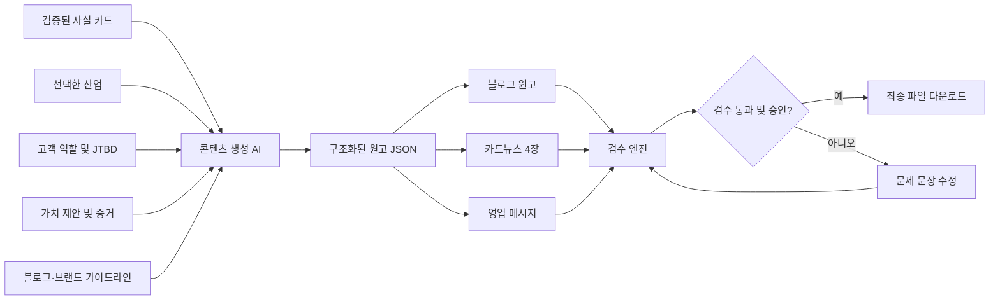
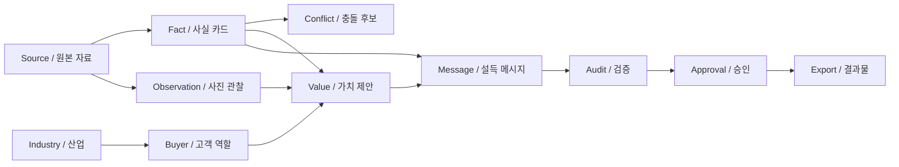

# 팩트마케터(FactMarketer) 최종 개발 계획서 v1.0
AI 스마트워크톤 Track A | 2026.11.20

**프로젝트명**: 팩트마케터 — 근거 기반 B2B 마케팅 전략·콘텐츠 자동화 플랫폼

**핵심 정의**: 기업의 제품 자료와 설치 현장 사진을 분석하여 AI가 목표 산업과 구매 고객을 추천하고, 고객별 설득 전략과 홍보 콘텐츠를 제작하며, 원문 근거를 검수하는 마케팅 의사결정 지원 시스템.

이번 계획은 실제 대회에서 작동하는 결과물을 확보하면서, 향후 다른 B2B 기업으로 확장할 수 있도록 설계한다.

공식 Track A의 평가 기준은 실용성·보편성 40점, 창의성·참신성 30점, 난이도·완성도 30점이다.

## 최종 개발 방향
**FACT** 기업 자료·현장 분석 → **STRATEGY** AI 시장·고객 전략 추천 → **CREATE** 고객별 콘텐츠 제작 → **VERIFY** 근거 검증·사람 승인

> **핵심 구현 원칙**: 이미지나 문서만으로 실제 매출, 구매 가능성, 성능 우위를 확정하지 않는다. AI가 추천을 생성하고, 검증 가능한 근거와 불확실성을 표시하며, 최종 결정은 사용자가 내린다.

## 핵심 전략: 고객 이해 → 차별적 가치 → 신뢰와 증거
세 가지 관점을 팩트마케터 전략 엔진의 최상위 원칙으로 반영한다.

| 전략 원칙 | AI가 판단해야 할 질문 | 실제 출력 |
|---|---|---|
| 고객 이해 | 누가, 어떤 문제로, 왜 지금 구매하는가? | ICP·JTBD·구매 계기·반대 이유 |
| 차별적 가치 제안 | 왜 다른 제품이 아니라 우리인가? | 제품 기능 → 고객 가치 → 차별화 메시지 |
| 신뢰와 증거 | 고객이 무엇을 근거로 믿을 수 있는가? | 출처·도입 사례·조건·검증 상태 |

티링크 공식 홈페이지에는 사무실 근무자의 인터넷전화와 외부 근무자의 스마트폰을 하나의 녹취 서버에 연결한다는 설명이 있다. 또한 한국전력 고객센터에 3,000석 규모의 녹취 서버를 제공한 이력이 연혁에 명시되어 있다.

다만 "통합된 녹취 기록"과 "완전히 통합된 단일 고객 이력"은 동일한 기능이 아닐 수 있으므로, 후자는 CRM 연동 자료를 확인한 뒤 홍보 문구에 반영한다.

전략 엔진은 AI에게 "STP 분석해 줘"라고 요청하는 방식보다, **고객 문제 → 구매 계기 → 기능에 근거한 고객 가치 → 반대 의견 → 증거 → 최적 설득 문장**을 구조화해 출력하도록 설계한다.

---

# 시스템 설계도 v1.0
코딩에 들어가기 전에 전체 시스템 구조, AI가 판단하는 방식, 데이터 흐름, 사용자 화면부터 확정한다.

팩트마케터는 단순한 홍보물 생성기가 아니라 **AI 마케팅 전략 컨설턴트 + 홍보 콘텐츠 제작자 + 사실 검증 시스템**을 결합한 B2B 마케팅 자동화 플랫폼이다.

설계에서 가장 중요한 세 가지:
1. **고객 이해**: 누가, 어떤 문제 때문에, 왜 지금 구매하는가?
2. **차별적 가치**: 경쟁 대안이 아니라 우리 제품을 선택해야 하는 이유는?
3. **신뢰와 증거**: 고객이 그 주장을 믿을 수 있는 근거는 무엇인가?

이 세 가지가 모든 AI 분석과 콘텐츠 제작의 기준이 된다.

## 1. 전체 시스템 아키텍처
**입력**: 제안서 · 매뉴얼 · 회사소개서 · 제품 사진 · 설치 현장 사진

1. **FACT ENGINE** — 자료 추출 · 이미지 판독 · 사실 카드 구축 · 출처 및 충돌 관리 (문서 분석 / 사진 분석 / 근거 저장소)
2. **STRATEGY ENGINE** — 시장별 적합성 · STP/ICP · JTBD · 구매위원회 · USP · 전략 추천 (고객 이해 / 차별적 가치 / 신뢰·증거)
3. **CONTENT ENGINE** — 선택한 산업·구매 결정자별 홍보물 자동 생성 (카드뉴스 / 블로그 / 영업 메시지)
4. **VERIFY ENGINE** — 수치·제품 기능·고객사명·출처·가이드라인 검사

**출력**: 담당자 최종 승인 → 다운로드 (검증된 콘텐츠와 근거 보고서)

네 엔진은 서로 독립적인 기능이지만, 사용자는 **업로드 → 전략 확인 → 콘텐츠 검수·다운로드**라는 하나의 흐름으로 이용한다.

## 2. 핵심 설계 원칙
| 구분 | AI 담당 | 프로그램 담당 | 사람 담당 |
|---|---|---|---|
| 자료 분석 | 문장 의미 해석 | 페이지·위치·출처 보존 | 자료 제공 |
| 사진 분석 | 장비·설치 환경 추정 | 파일 및 메타데이터 관리 | 판독 결과 확인 |
| 시장 분석 | 산업 적합성 추론 | 점수 계산·미확인 항목 표시 | 공략 산업 선택 |
| 마케팅 전략 | JTBD·가치 제안 생성 | 근거 연결·상태 관리 | 전략 승인 |
| 콘텐츠 생성 | 설득 문구 작성 | 템플릿·파일 출력 | 표현 검수 |
| 사실 검증 | 의미적 일치 여부 검토 | 수치·규칙·필수 항목 검사 | 최종 사실 확인 |

AI에게 전략적인 추천 권한은 주되, 확인되지 않은 사실을 마음대로 확정하거나 외부로 게시할 권한은 주지 않는다.

## 3. 핵심 데이터 설계: 사실 카드와 근거 저장소
가장 중요한 데이터는 원본 PDF가 아니라 **원문과 연결된 구조화된 사실 카드(Fact Card)**다. 모든 전략과 광고 문장은 사실 카드를 참조한다.

### 사실 카드 예시 (예시 데이터 · 실제 자료 검증 전)
**FACT-001 · 제품 기능 · 근거 검토 필요**
| 항목 | 내용 |
|---|---|
| 주장 | 사무실 전화와 외근 직원의 휴대전화 녹취를 통합 관리할 수 있음 |
| 원문 출처 | 제품 제안서 / 페이지 위치 확인 필요 |
| 주장 종류 | 제품 기능 |
| 검토 사항 | 지원 기종, 회선 조건, 통합 범위 |
| 활용 대상 | 영업 관리자 · 전산 담당자 |

코드 저장 형태:
```json
{
  "fact_id": "FACT-001",
  "product_id": "PRODUCT-001",
  "statement": "원문에서 추출한 제품 기능",
  "claim_type": "product_feature",
  "evidence": [
    {
      "source_id": "DOC-001",
      "page": 5,
      "quote": "원문 발췌 내용"
    }
  ],
  "status": "needs_review",
  "qualifiers": [],
  "conflict_ids": [],
  "approved": false
}
```
`quote`는 실제 문서의 원문이어야 하고, `page`는 추출한 페이지 위치에서 가져온다. 찾을 수 없는 출처는 만들지 않고 미확인으로 표시한다.

### 문서 간 충돌 탐지 (검증 시나리오)
| 항목 | 탐지 방식 |
|---|---|
| 학교 도입 수 200여 개 / 150+ | 표현·집계 시점·범위 차이 검토 |
| 녹취 성공률 99% | 측정 조건과 적용 범위 확인 |
| PC폰 녹음 기능 | 지원 환경과 제한 조건 대조 |
| 암호화 방식 | 문서별 기술 설명 비교 |

200여 개와 150개 이상은 반드시 모순은 아니다(시점·집계 범위가 다를 수 있음). 따라서 시스템은 **확정적 충돌 / 범위·조건 불명확 / 추가 확인 필요**를 구분한다.

또 자료에 수치가 있다고 해서 독립적으로 검증된 사실이 되는 것은 아니다. **원문과 일치하는지**와 **실제로 맞는 정보인지**를 별도로 관리한다.

## 4. AI 전략 의사결정 엔진 설계
AI는 시장 보고서를 쓰는 데서 그치지 않고 **어느 산업을 먼저 공략하고, 누구에게 무엇을 강조할지** 추천한다.

### 4-1. 산업별 시장 분석 (초기 산업 프로필 4종)
| 산업 | 범위 | 전략 초점 |
|---|---|---|
| 교육기관 | 학교·학원·교육행정 | 민원·상담 기록 관리와 도입 절차 |
| 콜센터 | 고객상담·CS 운영 | 통화 이력·상담 관리·운영 효율 |
| 의료기관 | 병원·의원·상담센터 | 예약 상담과 기록 관리, 개인정보 처리 요건 확인 필요 |
| 무역·물류 | 수출입·운송·고객 대응 | 거래처 소통과 이력 관리 |

네 산업 모두 지원하되, **초기 시연은 교육기관과 콜센터 중심**. 의료·무역은 산업 템플릿은 만들되, 제품 적합성이 검증되지 않았다면 시장 진입 추천을 확정하지 않는다.

### 4-2. 시장 적합성 평가 기준
| 평가 기준 | 가중치 | 데이터 근거 |
|---|---|---|
| 제품·시장 적합성 | 30% | 제품 기능과 산업 요구사항 |
| 기존 고객·도입 근거 | 25% | 실제 도입 사례·고객 자료 |
| 고객 문제의 시급성 | 20% | 고객 인터뷰·업무 자료·시장 조사 |
| 시장 접근 용이성 | 15% | 영업 채널·구매 절차 |
| 규제·도입 장벽의 낮음 | 10% | 보안·조달·기술 요건 |

각 항목은 충분한 근거가 있을 때만 1~5점으로 평가하고, 가중합으로 우선순위를 계산한다. 정보가 없는 항목에 AI가 임의 점수를 채우면 안 되며, **판단 보류**로 표시하고 추가로 필요한 자료를 안내한다.

### 4-3. 고객별 설득 전략 생성
시장 선택 이후 AI는 아래 여섯 항목을 생성한다(콘텐츠 생성의 입력).

| 항목 | 질문 |
|---|---|
| Who | 실제 구매 결정자는 누구인가? |
| Problem | 현재 어떤 업무 문제를 겪는가? |
| Why Now | 어떤 사건이 구매 필요성을 높이는가? |
| Value | 제품이 제공할 수 있는 구체적 가치는? |
| Objection | 구매를 망설이는 이유는? |
| Proof | 주장을 뒷받침하는 실제 증거는? |

예: 영업 관리자에게는 통화 기록과 업무 누락 문제를 중심으로 설득하고, 전산 담당자에게는 도입 조건과 호환성에 대한 우려를 해소하는 메시지를 작성한다.

구매 계기나 고객의 고충은 기업 자료만으로 확정할 수 없으므로 **'AI 추론'**으로 표시하고, 고객 인터뷰 자료가 있으면 근거를 강화하는 구조로 만든다.


---

# 개발 계획서 v1.0 (이어서) — 5~11절

## 5. 콘텐츠 생성 엔진 설계
콘텐츠 엔진은 제품 설명만 입력받지 않는다. **사실 카드 + 산업 정보 + 구매 결정자 + 설득 전략 + 콘텐츠 가이드라인**을 결합해서 결과물을 생성한다.

### 콘텐츠 생성 데이터 흐름


각 콘텐츠의 객관적 사실 주장에는 `fact_id`를 연결한다. 예를 들어 카드뉴스에 "전국 ○○개 기관에 공급"이 있다면, 그 수치가 어떤 원문에서 나왔는지 확인할 수 있어야 한다.

### 카드뉴스 4장 구성
| 장 | 내용 | 설득 목적 |
|---|---|---|
| 1장 | 고객의 문제 | 관심 유도 |
| 2장 | 문제 해결 방식 | 제품 가치 전달 |
| 3장 | 기능·도입 사례·근거 | 신뢰 형성 |
| 4장 | 도입 제안 및 CTA | 문의 유도 |

산업과 구매 결정자가 바뀌면 문구와 강조할 근거도 바뀌도록 설계한다.

## 6. 사실 검증 엔진 설계
검증 엔진은 두 단계로 나눈다.

**1차 코드 검증**
- 숫자 및 단위 일치 검사
- 고객사명과 공개 가능 여부 검사
- 필수 키워드 3개 검사
- 블로그 미션 11개 준수 검사
- 사용 금지 표현 검사
- 출처 누락 여부 검사

**2차 AI 의미 검증**
- 원문이 실제로 해당 주장을 뒷받침하는지
- 제품 기능을 과장했는지
- 제품 기능의 적용 조건이 빠졌는지
- 비교 우위에 근거가 있는지
- 고객의 예상 문제를 확인된 사실처럼 표현했는지

AI 의미 검증은 판정 오류가 발생할 수 있으므로 최종 진실 판정이 아니라 **검토가 필요한 주장 식별**에 사용한다.

### 검수 상태
| 상태 | 의미 |
|---|---|
| **PASS** — 자동 검사 통과 | 설정된 검사에서 문제를 발견하지 못함. 사실의 절대적 진실성을 보장하지는 않음 |
| **REVIEW** — 사람 검토 필요 | 근거 부족, 의미적 불일치 의심, 적용 조건 불명확 |
| **BLOCK** — 승인 불가 | 명백한 수치 불일치, 필수 규칙 위반, 승인되지 않은 고객 정보 포함 |
| **NOT CHECKED** — 검사 미실행 | 분석 실패, 자료 누락 또는 모델 호출 오류 |

최종 승인 버튼은 필수 검사가 완료되고 BLOCK 항목이 해소된 뒤에만 활성화된다. REVIEW 항목은 담당자가 확인하고 처리 기록을 남겨야 한다.

## 7. 사용자 웹 화면 설계
Python + Streamlit, 메인 탭 3개.

### 화면 A — 기업 분석 및 전략
- **자료 입력**: PDF · PPTX · XLSX · 이미지 / 기업명 · 제품명 · 분석 대상 산업
- **분석 결과 요약**: 사실 카드 수 · 불일치 후보 수 · 분석 산업 수 (목업의 "24개 / 4개 / 4개"는 예시 값이며 실제 처리 결과가 아님)
- **AI 전략 추천 결과**: 산업 적합성 · 고객 문제 · 차별적 가치 · 핵심 근거 — 교육기관 / 콜센터 / 의료기관 / 무역·물류 각각 "근거 확인 및 전략 평가"

AI 추천 순위와 함께 **왜 그 시장을 추천했는지, 어떤 정보가 부족한지**를 보여준다.

### 화면 B — 맞춤형 콘텐츠 제작
사용자가 산업·고객 역할·콘텐츠 유형을 선택하고 생성 결과를 비교한다.
- **대상 산업**: 학교 / 콜센터 / 의료 / 무역
- **구매 결정자**: 경영진 / 실무 관리자 / 전산 담당자
- **콘텐츠 유형**: 카드뉴스 / 블로그 / 영업 메시지
- **전략 미리보기**: 예) 대상: 학교 / 경영진, 출력: 카드뉴스. 선택한 조합에 맞는 고객 문제·가치 제안·근거 목록을 표시하고, 승인된 자료로 콘텐츠를 생성

### 화면 C — 근거 검증 및 승인
| 영역 | 표시 내용 |
|---|---|
| 왼쪽 | 생성된 블로그·카드뉴스 문장 |
| 오른쪽 | 연결된 사실 카드·원문 출처 |
| 상단 | 검사 통과율, 경고 수, 차단 수 |
| 하단 | 수정, 재검증, 승인, 다운로드 |

문장을 클릭하면 해당 주장에 연결된 원문과 검증 상태를 볼 수 있어야 한다. **승인 이후 원고를 수정하면 승인 상태를 자동 해제하고 다시 검증**한다.

## 8. 실제 코드 구조
초기에는 마이크로서비스나 복잡한 DB 없이 하나의 Python 애플리케이션으로 구현한다.
```
factmarketer/
├── app.py                 # Streamlit 메인 화면
├── requirements.txt
├── .env.example
├── README.md
├── core/
│   ├── ingest.py          # PDF/PPT/Excel 텍스트 추출
│   ├── vision.py          # 현장 사진 분석
│   ├── facts.py           # 사실 카드 추출 및 저장
│   ├── conflicts.py       # 자료 간 불일치 탐지
│   ├── strategy.py        # 시장 및 고객 전략
│   ├── content.py         # 홍보 콘텐츠 생성
│   ├── validation.py      # 규칙·근거 검증
│   └── export.py          # 이미지·문서 출력
├── providers/
│   ├── claude.py
│   └── gemini.py
├── templates/
│   ├── industry_profiles.json
│   ├── buyer_roles.json
│   └── marketing_rules.json
├── data/
│   ├── sources/
│   ├── facts/
│   ├── strategies/
│   └── outputs/
└── tests/
    ├── test_extraction.py
    ├── test_conflicts.py
    ├── test_validation.py
    └── test_end_to_end.py
```

### AI 모델의 역할
| 모델 | 담당 작업 | 대체 방안 |
|---|---|---|
| Claude | 사실 추출, STP/JTBD/USP, 전략 추천, 콘텐츠 작성, 의미 검토 | JSON 검증·재시도, 필요한 경우 다른 모델 사용 |
| Gemini | 설치 사진 판독, 이미지 관련 추가 검토 | 사용 가능한 비전 모델로 대체 |
| Python | 데이터 처리, 점수 계산, 정형 규칙 검사, 파일 생성 | 외부 AI 없이 로컬 수행 |

AI 출력은 가급적 정해진 JSON 구조로 받고, Pydantic 등으로 필수 필드와 데이터 타입을 검증한다.

**보안 설계**
- 파일 안에 "이전 지시를 무시하라" 같은 문장이 있어도 명령으로 실행하지 않도록, 문서와 사진 분석 결과는 **신뢰할 수 없는 입력 데이터**로만 취급한다.
- 민감한 서버 정보·고객명·전화번호는 외부 AI에 전송하기 전 마스킹하거나 전송 승인을 받는다.
- API 키는 소스코드나 GitHub에 포함하지 않는다.

## 9. 핵심 데이터 연결 구조
모든 정보를 서로 추적할 수 있도록 다음 관계를 유지한다. (원문 다이어그램의 노드를 텍스트에서 재구성)

특히 **Message는 어떤 Fact와 Value를 사용했는지 기록**해야 한다. 이를 통해 결과물의 출처를 역추적할 수 있다.

## 10. 구현 우선순위와 완료 기준
### 1차: 필수 MVP (최우선)
- [ ] 제품 자료 PDF/PPTX 텍스트 추출
- [ ] 현장 사진 1장 분석
- [ ] 근거와 페이지가 있는 사실 카드 생성
- [ ] 학교·콜센터 시장 전략 비교
- [ ] 구매 결정자 3유형의 설득 전략 생성
- [ ] 카드뉴스 4장과 블로그 원고 생성
- [ ] 수치·키워드·출처 검수
- [ ] 담당자 승인 및 파일 다운로드

### 2차: 시간 여유가 있을 때 (확장 기능)
- [ ] 의료·무역 산업별 전략 심화
- [ ] 두 모델 간 의미 검토 비교
- [ ] 수정 표현과 검수 규칙 저장
- [ ] 전략 보고서 PDF 출력
- [ ] 다수 제품·사진 일괄 처리

### 최종 통합 테스트 기준
- 제품 자료 1종 이상과 현장 사진 1장을 입력해 전체 분석이 완료됨
- 학교·콜센터 두 시장의 고객 문제, 가치 제안, 근거가 구분되어 출력됨
- 경영진·실무 관리자·전산 담당자별 홍보 문구가 서로 다른 설득 포인트를 가짐
- 의도적으로 잘못 삽입한 수치와 출처 없는 주장이 검수에서 발견됨
- 원문 위치를 사용자가 확인할 수 있고 미확인 주장이 자동 승인되지 않음
- 모든 승인된 결과물이 정상적으로 다운로드됨
- AI 호출 실패, 손상된 파일, 출처 누락 시 프로그램이 중단되지 않고 오류를 표시함
- 실제 원문과 비교한 검출률·오탐률을 측정하여 시연에 포함함

## 11. 대회 발표에서 보여줄 최종 시나리오
1. **기업 자료와 현장 사진 입력** — 티링크 제품 자료를 불러오고 AI가 사실 카드를 생성한다.
2. **AI가 산업별 공략 전략 추천** — 학교와 콜센터 중 어느 시장에 어떤 근거가 있고, 무엇을 추가로 확인해야 하는지 비교한다.
3. **구매 결정자별 메시지 비교** — 동일한 제품을 경영진에게는 경영적 가치로, 실무 관리자에게는 업무 문제 해결로, 전산 담당자에게는 설치·운영 관점으로 설명한다.
4. **AI가 카드뉴스·블로그 자동 제작** — 선택한 고객군의 구매 동기와 사실 카드에 기반한 콘텐츠가 완성된다.
5. **일부러 잘못된 수치를 넣어 검증** — 검수 시스템이 문제 문장을 식별하고 근거 출처를 보여준다.
6. **수정·승인 후 다운로드** — 검수를 완료한 결과물과 근거 보고서를 출력한다.

## 최종 설계 결론
팩트마케터의 핵심 경쟁력은 광고 자동 생성 자체가 아니라, **AI의 전략 추천과 근거 검증을 연결**하는 데 있다.

**기업 자료 → 사실 카드 → 고객 이해 → 차별적 가치 제안 → 근거 기반 설득 → 홍보 콘텐츠 → 검증·승인**

티링크를 1차 적용 기업으로 사용하면서도, 산업 프로필과 기업 자료만 교체해 다른 B2B 솔루션 기업에 적용할 수 있는 구조를 갖춘다.

다음 개발 단계에서는 이 설계도를 기준으로 **JSON 데이터 모델과 네 개 엔진의 입출력 계약**부터 확정한 뒤, Claude Code에 단계별 구현을 맡긴다.
